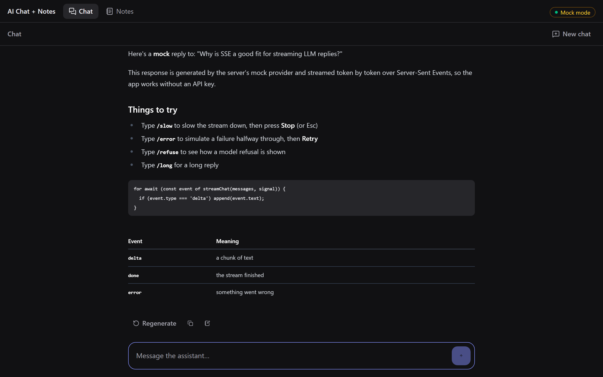
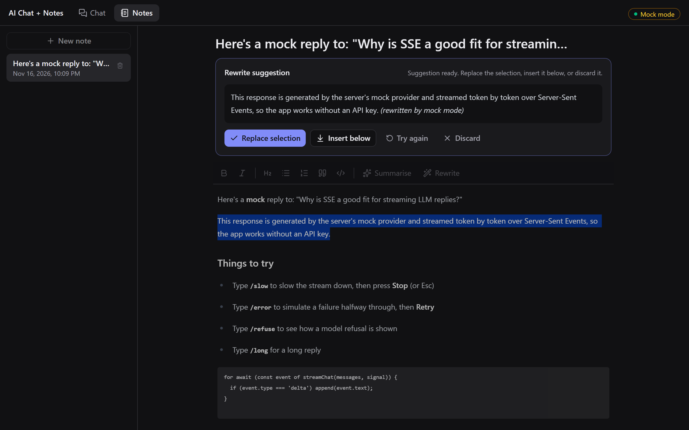
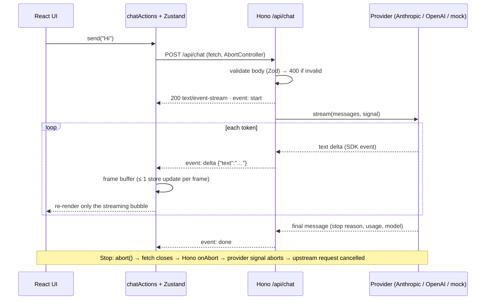

# AI Chat + Notes

A small AI-native app that has two parts: a **chat** whose replies stream in token by token, and **notes** where you can save any reply and ask the AI to summarise or rewrite a passage, also streamed.

It's built as a frontend portfolio project. Its focus is the parts of AI product UIs that are hard to get right: streaming, cancellation, error recovery, rich-text editing and accessibility while content is still arriving.

<!-- Replace with a short screen recording: docs/demo.gif (see "Recording the demo" below) -->

> 🎬 **Demo GIF:** _coming soon_ (`docs/demo.gif`)

| Chat (streamed Markdown reply)         | Notes (streamed rewrite suggestion)      |
| -------------------------------------- | ---------------------------------------- |
|  |  |

**Stack:** Vite · React 19 · TypeScript · Tailwind v4 · Zustand · TanStack Query · TipTap 3 · Hono · Zod · Vitest · Playwright · Storybook 10

---

## Features

**Chat**

- Replies stream in token by token over **Server-Sent Events**.
- **Stop** with the button or <kbd>Esc</kbd>. The partial reply is kept, and the server also cancels the upstream LLM request.
- **Retry** after an error, and **Regenerate** for the latest reply.
- Distinct states for stopped, mid-stream error, non-retryable error (e.g. a bad API key), model refusal and the length limit.
- Safe **Markdown** rendering (GFM: tables, code blocks, task lists).
- Auto-scroll follows the stream only while you're at the bottom. Otherwise a "Jump to latest" button appears.
- The conversation is persisted to `localStorage`. A reply that was mid-stream when you reloaded is marked "stopped".

**Notes**

- **TipTap** rich-text editor with an accessible toolbar.
- **Save to notes** on any chat reply (Markdown → rich text).
- **Summarise / Rewrite** a selection. The suggestion streams into a preview, and you choose to **Replace**, **Insert below** or **Discard**. Accepting is one undo step.
- Delete with **Undo**. Notes are persisted to `localStorage`.

**Backend proxy**

- A thin **Hono** server, so the API key never reaches the browser.
- Swappable providers: **Anthropic**, **OpenAI**, or **mock** (fake streamed replies, no key needed).

---

## Quick start (mock mode, no API key)

Requires **Node 22+**.

```bash
npm install
npm run dev
```

Open http://localhost:5173. The header badge says **Mock mode**. Replies are generated locally and streamed exactly like a real model's.

Mock mode can simulate the hard-to-reproduce cases. Put one of these in a message:

| Trigger   | What happens                                      |
| --------- | ------------------------------------------------- |
| `/slow`   | Streams 8× slower (try **Stop** / <kbd>Esc</kbd>) |
| `/error`  | Fails a third of the way through (try **Retry**)  |
| `/fail`   | Fails before the first token                      |
| `/refuse` | Ends with a model refusal                         |
| `/long`   | A long reply (try scrolling up while it streams)  |

## Running with a real model

```bash
cp apps/server/.env.example apps/server/.env
```

Then edit `apps/server/.env`:

```ini
LLM_PROVIDER=anthropic          # or openai
ANTHROPIC_API_KEY=sk-ant-...    # or OPENAI_API_KEY=...
```

and restart `npm run dev`. The key is only read by the server.

| Variable              | Default            | Notes                                                             |
| --------------------- | ------------------ | ----------------------------------------------------------------- |
| `LLM_PROVIDER`        | `mock`             | `mock`, `anthropic` or `openai`                                   |
| `ANTHROPIC_MODEL`     | `claude-opus-5-5`  |                                                                   |
| `ANTHROPIC_EFFORT`    | `low`              | `low` … `max`, or `off` to omit it (older models)                 |
| `ANTHROPIC_FALLBACKS` | on where supported | Server-side refusal fallback to another model, in the same stream |
| `OPENAI_MODEL`        | `gpt-5-mini`       |                                                                   |
| `MOCK_DELAY_MS`       | `30`               | Delay between mock tokens                                         |
| `PORT`                | `8787`             | API port (Vite proxies `/api` to it)                              |

---

## Architecture

```
apps/
  web/        React app (Vite)        ← everything the user sees
  server/     Hono proxy (Node)       ← holds the API key, talks to the LLM
packages/
  shared/     Zod schemas + SSE parser, imported by both
e2e/          Playwright tests (whole stack in mock mode)
```

### How streaming works end to end



1. **Browser → server.** The client POSTs the conversation with `fetch` and reads `response.body` as a stream. It doesn't use `EventSource`, which can only send GET requests: no JSON body, no custom headers and no `AbortController`.
2. **Validation before streaming.** The server validates the body with the shared Zod schema. Invalid input gets a normal `400` JSON error, _before_ any stream opens.
3. **One event format for every provider.** Each provider adapter turns its SDK's events into four events: `start`, `delta`, `done` and `error`. The UI never knows which LLM it's talking to. Mock mode is just a third adapter.
4. **Errors in-band.** Once the `200` and the stream have started, the status code can't change, so failures arrive as an `error` event with a `code` and a `retryable` flag. Unknown errors are replaced with a generic message, so stack traces and keys never reach the client.
5. **Parsing.** The client uses a small SSE parser from `packages/shared`. It's a pure `feed(chunk) → messages[]` state machine, tested against every possible chunk split, including `\r\n` pairs and multi-byte characters split across chunks. The server's tests read responses through the **same parser**.
6. **Rendering.** Deltas go into a frame buffer that flushes to the Zustand store at most once per animation frame. Only the streaming message object changes, so every other (memoised) bubble skips re-rendering.
7. **Cancellation.** `abort()` closes the HTTP connection. Hono's `onAbort` fires and aborts the provider SDK call, so tokens nobody will read aren't generated or billed.

### Key decisions (and why)

| Decision                                                             | Why                                                                                                                                                                                                                                                                                 |
| -------------------------------------------------------------------- | ----------------------------------------------------------------------------------------------------------------------------------------------------------------------------------------------------------------------------------------------------------------------------------- |
| **SSE over WebSockets**                                              | LLM output only flows server → client. SSE is plain HTTP: it works with proxies, auth and HTTP/2, needs no connection protocol, and is easy to debug with `curl -N`. Bidirectional features would justify WebSockets; this app doesn't need them yet.                               |
| **`fetch` + `ReadableStream` instead of `EventSource`**              | We need POST bodies and cancellation.                                                                                                                                                                                                                                               |
| **The streaming lifecycle lives outside React** (`chatActions.ts`)   | If it lived in a component's `useEffect`, switching to Notes would unmount it and kill the stream. As plain functions writing to a store, replies keep streaming in the background, and the logic is testable without rendering anything.                                           |
| **Zustand for UI and client state, TanStack Query for server state** | `/api/config` is classic request/response data (caching, retries, refetch on focus), which is what Query is for. A streamed chat is a long-lived, cancellable, incrementally-updating write, which doesn't fit `useQuery`, so it lives in a store.                                  |
| **AI edits stream into a preview, not into the document**            | The editor is read-only while a suggestion streams, so the selected range can't go stale. Accepting is a single ProseMirror transaction, so one Undo reverts it.                                                                                                                    |
| **TipTap through an imperative handle**                              | Re-serialising the document into a controlled prop on every keystroke fights ProseMirror's own state (cursor, undo history). The parent calls `replaceRange` / `insertAfter` instead.                                                                                               |
| **Prompt-injection guard for notes**                                 | Selected text is wrapped in `<passage>` tags, and the system prompt says to treat it as content rather than instructions.                                                                                                                                                           |
| **Safe rendering**                                                   | `react-markdown` builds React elements and ignores raw HTML. Markdown saved to notes goes through TipTap's schema parser, which drops anything that isn't a known node (so no `<script>` or `onclick`).                                                                             |
| **Anthropic defaults**                                               | `claude-opus-5-5` with `effort: "low"` keeps time to first token short for chat. The server-side refusal fallback is on: if the model declines mid-stream, the API continues on a fallback model in the _same_ stream, and `done` reports the model that actually served the reply. |
| **npm workspaces + `no-extraneous-dependencies`**                    | No extra tooling for people who clone the repo. The ESLint rule blocks the "phantom dependency" problem that npm's hoisting allows.                                                                                                                                                 |

---

## Accessibility

- **Streaming narration.** The visible message is `aria-busy` while streaming and is deliberately _not_ a live region: screen readers handle rapidly changing live regions badly, either reading every token or re-reading the whole message. A separate polite region announces "Assistant is responding", then **whole sentences** batched at most every 1.5 s, then the outcome (complete, stopped, error or refusal). Markdown syntax is stripped, and code blocks are announced as "Code block".
- **Keyboard.**
  - <kbd>Enter</kbd> sends and <kbd>Shift</kbd>+<kbd>Enter</kbd> adds a newline. IME composition never sends.
  - <kbd>Esc</kbd> stops a reply, and stops or discards an AI suggestion.
  - The editor toolbar is a WAI-ARIA toolbar with a roving tabindex: one Tab stop, then arrow keys, <kbd>Home</kbd> and <kbd>End</kbd>.
- **Focus management.**
  - When Stop or Retry disappears, focus goes back to the composer rather than falling to `<body>`.
  - Switching views focuses the new view's heading.
  - AI suggestions move focus to Stop while streaming, then to the primary action when they finish.
- **Other basics:** a skip link, `aria-pressed` on formatting toggles, labelled icon buttons, `prefers-reduced-motion` support, and dark mode via `prefers-color-scheme`.
- **Checked automatically.** Playwright runs **axe** (WCAG 2 A/AA) on the chat view, and Storybook's a11y addon checks every story.

---

## Testing

```bash
npm test             # Vitest: shared parser, server routes & providers, web logic & components
npm run test:e2e     # Playwright: full stack in mock mode (run `npx playwright install chromium` once)
npm run storybook    # Storybook on http://localhost:6006
```

- **Unit / integration (Vitest):**
  - SSE parser edge cases
  - server routes through real HTTP semantics (`app.request()`), including client-disconnect → upstream abort
  - provider adapters with injected fake SDK clients
  - chat lifecycle (send, stop, retry, errors)
  - the notes transform hook, the toolbar keyboard model, and screen-reader narration and focus.
- **E2E (Playwright):**
  - token-by-token streaming and Markdown rendering
  - Esc to stop
  - mid-stream error + Retry
  - save to notes
  - summarise + insert
  - the axe scan.
- **Storybook:** every visual state of `MessageBubble`, `Composer`, `NoteEditor` and `AiPreviewPanel`, a live token-replay story, and a `play()` interaction test.
- **CI** (`.github/workflows/ci.yml`) runs Prettier, ESLint, typecheck, unit tests, the app and Storybook builds, and E2E. No API key is needed.

## Scripts

| Command               | What it does                                                    |
| --------------------- | --------------------------------------------------------------- |
| `npm run dev`         | Server (`:8787`) + web (`:5173`) with hot reload                |
| `npm run build`       | Production build of the web app                                 |
| `npm run lint`        | ESLint                                                          |
| `npm run typecheck`   | TypeScript across all workspaces + e2e                          |
| `npm test`            | Vitest in every workspace                                       |
| `npm run test:e2e`    | Playwright                                                      |
| `npm run storybook`   | Storybook                                                       |
| `npm run screenshots` | Regenerate the README screenshots (needs `npm run dev` running) |

### Recording the demo

With `npm run dev` running in mock mode, record about 20 seconds of:

1. a streamed reply
2. `/slow` + <kbd>Esc</kbd>
3. `/error` + Retry
4. Save to notes → select a paragraph → Rewrite → Replace.

Save the recording as `docs/demo.gif` and replace the placeholder above.

---

## Known limitations and next steps

- **WebSocket transport** behind the same `streamEvents()` interface (planned), to compare the two transports.
- One conversation for now. Multiple conversations would be a list in the same store.
- `localStorage` is fine for v1. IndexedDB (or a real backend) is the next step for large notes.
- Markdown tables in saved replies are flattened, because the editor doesn't include TipTap's table extension yet.
- No auth or rate limiting on the proxy. It's meant to run locally; put it behind both before deploying publicly.
